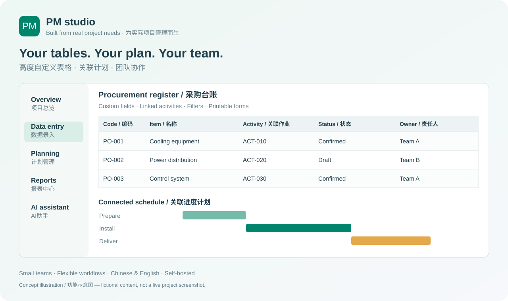
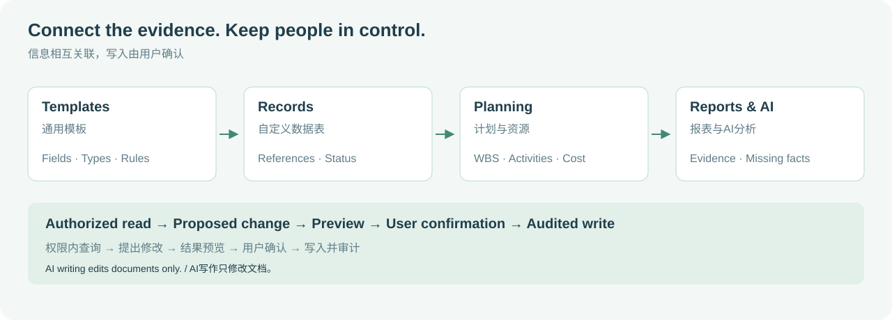

<div align="center">

# PM studio

**A project manager’s workspace, built from real project needs.**  
**一个项目经理，从实际管理需求出发做的项目管理工具。**

[English](#english) · [简体中文](#简体中文) · [Apache-2.0](LICENSE) · **V0.62.29**



</div>

## English

### Why I built this

I am a project manager who does not know how to code. I built PM studio with AI assistance, starting from problems I encounter in project work: scattered spreadsheets, disconnected schedules, repeated reporting and information that is difficult to trace.

This is a practical project management tool for **small teams** who want to organize their work, share consistent information and **improve project management efficiency**. Its roots are in engineering and construction, but its **highly customizable tables** make it adaptable to different team workflows.

This is a developing project. You are welcome to study the code, try it with fictional data, report problems and help improve it.

### Features

| Area | What you can do |
| --- | --- |
| **Customizable tables** | Custom columns/types, required fields, automatic codes, formulas, references, filters, grouping, column widths, inline editing, import/export and printable forms. |
| **Planning** | Hierarchical WBS, activities and dependencies, project calendars, CPM, float, baselines, Gantt and time-scaled network diagrams. |
| **Resources and cost** | Resource pools, assignments, load checks, time-phased curves, unit prices, planned/actual/remaining cost and earned-value calculations. |
| **Reports and approvals** | Reusable templates across nine business categories, recurring generation, snapshots, printable forms and approval workflows. |
| **Team workspace** | Organization charts, files, calendar, documents, Markdown notes, offline draw.io and practical reference tools. |
| **AI assistance** | Authorized data queries, linked-record analysis and proposed changes with preview and final confirmation. Document writing has a separate entry point. |
| **Control and traceability** | Workspace/project isolation, roles, record-status confirmation, audit logs, backup settings and business-rule checks. |

The interface supports **Chinese and English**. PostgreSQL schema, migrations, reusable templates and business calculations are included.

### Connected information



Tables can connect people, procurement, activities, resources and reports through explicit references. Users only access authorized information. Draft records require an authorized status confirmation before shared use and calculations. AI queries are read-only by default; proposed business writes need explicit review and confirmation. AI writing edits documents only.

Both images are **conceptual illustrations with fictional content**, not screenshots of a live project.

### Quick start — Docker

Requirements: **Node.js 22**, Docker Engine/Desktop and **Compose v2**.

```sh
npm ci
node scripts/setup-env.mjs
docker compose up -d --build
```

Open **http://localhost:9090**. Unique random initial credentials for `admin` and `superadmin` are written to `secrets/initial-accounts.txt`; change them after first use. Never publish that file or generated environment files.

The migration service initializes the database structure and administrator accounts. `SEED_DEMO=false` by default: **no original user or project records** are imported. Apply reusable templates when creating a project. PostgreSQL persists in a Docker volume; deleting the volume deletes its data.

```sh
docker compose ps
docker compose logs --tail=100 migrate app
```

The clean source has passed build and unit checks. A fresh Docker deployment still requires validation in your environment; see [verification scope](docs/SOURCE_EXPORT.md).

### Local PostgreSQL

1. Install Node.js 22 and PostgreSQL 16; run `npm ci`.
2. Run `node scripts/setup-env.mjs`, or consult `.env.example` and `.env.migrate.example`.
3. Create a dedicated `project_studio` database and migration account `studio`. Point `.env.migrate` to that **new** database. Initialization requires permission to create tables, roles and grants.
4. Initialize, build and start:

```sh
node --env-file=.env.migrate --import tsx server/migrate.ts
npm run build
node --env-file=.env --import tsx server/index.ts
```

The runtime must use restricted role **`studio_app`**. `APP_DB_PASSWORD` is 48 hexadecimal characters. `ENCRYPTION_KEY` is 64 hexadecimal characters and must match between migration and runtime. Existing database-role passwords are not automatically rotated on migration.

Native startup defaults to `127.0.0.1:9090`. For frontend development, keep the backend running and run `npm run dev` in another terminal. Backups need compatible `pg_dump` / `pg_restore` in PATH, or `PG_DUMP_BIN` / `PG_RESTORE_BIN`; the recovery script accepts `STUDIO_PG_BIN`.

### AI and deployment

Configure your own provider, model and credentials in the application. Ollama and supported cloud protocols are optional; **no API keys or model weights are included**. Docker typically reaches host Ollama through `host.docker.internal`; Linux may need an explicit host mapping. Search capabilities depend on the configured service and network access.

Default deployment is local-only. Remote use requires HTTPS, the correct proxy configuration, `PUBLIC_ORIGIN`, `TRUSTED_PROXY_CIDRS`, secure cookies and the application's production checks before enabling `RELEASE_MODE=true`. Establish and test your own backups.

### Source and documentation

| Path | Contents |
| --- | --- |
| `src/` | React interface, localization, editors and charts |
| `server/` | API, permissions, services and SQL migrations |
| `shared/` | Types, template catalogs and calculation rules |
| `scripts/` | Setup, manuals and template utilities |
| `tests/` | Unit and environment-dependent integration/UI tests |
| `vendor/` | Offline draw.io with upstream license notices |
| `docs/` | Offline guides, publication notes and illustrations |

```sh
npm test
npm run typecheck
npm run build
node scripts/build-manual.mjs
```

Browser tests may need `npx playwright install chromium`. Integration scripts require a dedicated test environment and may write data; do not run them indiscriminately against production.

Download the [offline HTML manual](docs/MANUAL_GUIDE.html) and open it locally. The [detailed user guide](docs/USER_GUIDE.md) currently primarily uses Chinese; the application itself is bilingual.

### Privacy, contributions and support

The repository contains schema/migrations, reusable templates and business logic. It does **not** contain the original installation's accounts, business records, private documents, uploaded images, chat history, keys or backups. Private template instances created in that database are not included. Test fixtures and illustrations use fictional data.

Issues and pull requests are welcome. Include reproduction steps and fictional examples; keep personal information, business data and credentials out of issues and attachments. For sensitive security reports, use GitHub private vulnerability reporting when available rather than public issues.

The source is available under **Apache License 2.0**. Sponsorship is welcome. Deployment, training and maintenance can be offered as paid services; payment is not required to exercise the rights granted by the license. A sponsorship/payment channel has not yet been configured.

---

## 简体中文

### 为什么做这个工具

我是一个**不懂代码的项目经理**。在 AI 的帮助下，我把日常项目管理中遇到的问题逐步做成了 PM studio：分散的表格、脱节的计划、重复编制的报表，以及难以追溯的信息。

它面向希望理顺工作、共享一致信息、**提高项目管理效率的小团队**。最初需求来自工程建设项目，但由于**表格自定义程度高**，也可以按团队自己的业务流程调整。

这是一个持续完善的项目管理工具。欢迎研究代码、使用虚构数据试用、反馈问题和参与改进。

### 主要功能

| 模块 | 能做什么 |
| --- | --- |
| **自定义数据表** | 自定义列与类型、必填、自增编码、公式、关联、筛选、归类、列宽、单元格编辑、导入导出及打印表单。 |
| **计划管理** | 分层 WBS、作业及逻辑关系、项目日历、CPM、浮时、基线、横道图和双代号时标网络图。 |
| **资源与费用** | 资源池、作业资源分配、负荷检查、分时曲线、单价、计划/实际/剩余费用和挣值。 |
| **报表与审批** | 九类业务报表模板、周期生成任务、快照、打印单据和审批流程。 |
| **团队工作空间** | 组织架构、项目文件、事项日历、文档、MD笔记、离线 draw.io 和实用参考工具。 |
| **AI辅助** | 权限内查询、关联分析、业务变更预览与确认；AI写作保留独立入口。 |
| **权限与追溯** | 空间/项目隔离、角色权限、数据状态确认、审计、备份设置和业务规则检查。 |

界面支持**中英文切换**。源码保留数据库结构与迁移、通用表格和报表模板、业务逻辑及计算规则。

上方两幅图为使用虚构内容制作的**功能示意图**，不是真实项目截图。数据表通过明确引用关联人员、采购、作业、资源和报表；用户只能访问权限内的信息。草稿由有权限的主管或管理员确认状态后，才能共享和参与计算。AI默认只读，业务增删改需预览并最终确认；AI写作只修改文档。

### 快速启动

需要 **Node.js 22、Docker Engine/Desktop、Compose v2**。

```sh
npm ci
node scripts/setup-env.mjs
docker compose up -d --build
```

打开 **http://localhost:9090**。`admin` 和 `superadmin` 的独立随机初始密码保存在 `secrets/initial-accounts.txt`，首次使用后修改。不要上传该文件和生成的环境配置。

默认 `SEED_DEMO=false`，只初始化数据库结构和管理账号，**不导入原使用者数据**。新建项目后按需应用通用模板。数据库保存在 Docker 命名卷；删除卷会删除其中的数据。

源码已通过构建和单元测试；全新 Docker 部署仍需目标环境实测。详见[验证范围](docs/SOURCE_EXPORT.md)。本机 PostgreSQL 的完整配置与命令见[中文部署说明](docs/INSTALL.zh-CN.md)，也可参照上方英文部分。完整数据库结构应通过迁移程序创建，不能只执行一个 schema 文件。

### 模板、AI和使用指南

- 通用模板主要在 `shared/business-catalog.ts`、`shared/report-template-catalog.ts` 和对应服务中，保留字段、引用与报表规则。
- 不附带原数据库中的私人模板实例、业务数字、人员资料、采购单据或文档。
- AI需自行配置，可选择 Ollama 或支持的云端协议；不包含 API Key 和模型文件，联网能力依赖配置的服务。
- AI助手处理业务操作，AI写作只修改文档；两者都遵守用户权限和项目范围。
- [离线HTML指南](docs/MANUAL_GUIDE.html) 下载后在浏览器打开；[详细使用指南](docs/USER_GUIDE.md) 解释模块操作、数学公式和数据逻辑。
- 集成测试必须使用专门测试环境，不要直接对正式数据库批量运行。

远程使用前请配置 HTTPS、可信代理、公开访问地址、安全 Cookie，通过程序发布检查，并建立适合自己环境的备份和恢复方案。

### 开源与支持

本仓库不包含原部署的真实账号、个人信息、项目数据、附件、聊天、密钥、密码和备份；测试夹具为虚构数据。以后自行运行产生的敏感文件，也不要提交。

欢迎通过 Issues 和 Pull Requests 提出改进。请使用虚构数据，不附真实业务资料、密码和个人信息；敏感安全问题优先使用可用的 GitHub 私密漏洞报告渠道。

项目采用 **Apache License 2.0**，欢迎研究、使用和贡献。接受赞助，也可以提供收费的部署、培训和维护服务；使用许可证授予的权利不要求付费。目前尚未配置赞助或收款入口。

## License / 许可证

Copyright 2026 PM studio contributors.

Licensed under the **[Apache License, Version 2.0](LICENSE)**. Third-party components retain their own licenses and notices; see [third-party notices](docs/THIRD_PARTY_NOTICES.md) and [NOTICE](NOTICE).

主项目遵循 **Apache-2.0**，第三方组件保留各自版权与许可。
